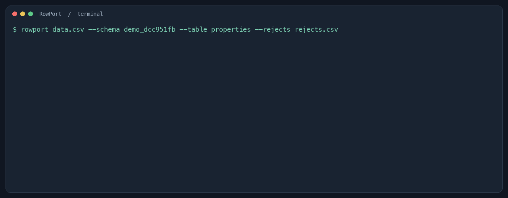
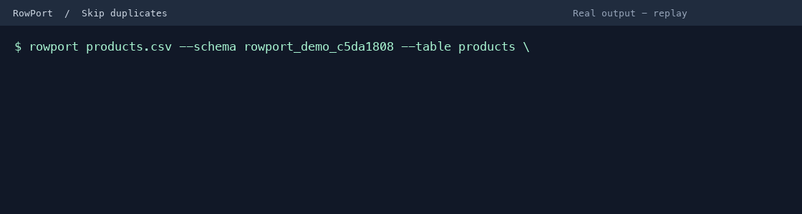

# RowPort

RowPort is a Python CLI that imports CSV files into an existing PostgreSQL table. It saves valid rows and writes rejected rows with their reasons to a CSV report.

## Quick demo with Docker



The demo above shows real output from a Docker run, replayed at an accelerated pace.

Install and start Docker with the Compose plugin, then clone this repository and run:

```sh
git clone https://github.com/Gianni300x/RowPort.git
cd RowPort
docker compose up --build --exit-code-from demo --attach demo
```

Compose starts a temporary PostgreSQL database, creates the example table and
imports 200,000 rows. Four rows have invalid prices, so a successful run reports
199,996 saved and 4 rejected. The rejection report is available at
`reports/rejects.csv` on your computer. The command stops the containers when the
import finishes; the demo database is temporary and its contents are discarded.
Each run starts with an empty database and overwrites the report. To remove the
stopped demo containers and network, run `docker compose down`.

To use your own database or CSV, follow the manual installation below.

## Requirements and installation

Python 3.10 or later and an accessible PostgreSQL database are required.

```sh
python3 -m venv .venv
source .venv/bin/activate
python -m pip install .
```

## Usage

Copy the configuration template to `.env` in the directory where you run RowPort,
then edit it with your PostgreSQL connection string:

```sh
cp .env.example .env
```

The `.env` file is ignored by Git because it can contain credentials. Use a single
line `DATABASE_URL=...` (optionally surrounded by single or double quotes). If a
username or password contains special URL characters, percent-encode them.

Create the example table in your database using `examples/properties.sql`, then run:

```sh
rowport examples/properties.csv --table properties --rejects rejects.csv
```

The connection can also be supplied as an environment variable or with `--dsn`.
The order of precedence is `--dsn`, the `DATABASE_URL` environment variable,
then `DATABASE_URL` in `.env`. The table must already exist. The default schema is `public`; use `--schema` to select another. See `rowport --help` for all options.

To check headers before importing, use:

```sh
rowport validate examples/properties.csv --table properties
```

This displays the CSV headers and the table's insertable and required columns.
It reports missing required or unknown columns and exits with a nonzero status
on errors. It does not examine row data or check types and constraints, and it
does not insert anything. Use `--schema` or `--dsn` when needed; the connection
configuration follows the same precedence as the import command.

When CSV headers differ from the table's column names, use `--map` for each
equivalence. Names are case-sensitive and must match exactly; quote arguments
containing spaces for your shell. Unmapped columns keep their original names.
The same mappings can be used for validation and import:

```sh
rowport validate properties.csv --table properties --map street=address --map bedrooms=rooms
rowport properties.csv --table properties --map street=address --map bedrooms=rooms --rejects rejects.csv
```

Mappings must reference existing CSV columns and distinct insertable table
columns. Rejected rows retain their original CSV values and column order.

The input must be UTF-8 CSV with unique headers matching insertable table columns. Columns marked `NOT NULL` without a default or identity are required; unknown columns prevent the import. Empty values are sent as empty strings, not `NULL`.

PostgreSQL validates types and constraints. Valid rows are inserted in one transaction; invalid rows are captured in the report. A database failure interrupts and rolls back the import. The report contains the CSV record number (header = 1), the original row encoded as CSV, and the rejection reason. It is written even when there are no rejected rows and overwrites the selected output file. If writing the report fails after commit, the CLI reports that rows were already saved.

By default, unique constraint violations are rejected like other invalid rows.
To skip violations reported on the target table instead, use:

```sh
rowport data.csv --table properties --rejects rejects.csv --skip-duplicates
```



This replay shows actual output from a test using a temporary PostgreSQL schema:
one new row is saved, two duplicate rows are skipped, and an invalid row is
written to the rejection report.

Skipped rows are counted separately and do not appear in the rejection report.
This relies on unique constraints or unique indexes in PostgreSQL: without one,
RowPort cannot identify duplicates. A conflict means a unique key already
exists; it does not guarantee that the rest of the row is identical. Violations
reported for another table, including a partition or a table affected by a
trigger, remain rejections. Deferred constraints may fail at commit and roll
back the import instead of being skipped.

Rows are read one at a time, and rejected rows are staged in a temporary file on
disk until the database transaction succeeds. Memory use therefore does not grow
with the number of rows, although disk space is needed for the rejection report.

During import, RowPort prints a progress line every 10,000 processed rows, with
the counts processed, saved pending commit, and rejected. These counts are
provisional: an error can roll back all pending inserts. The final summary is
printed after the transaction commits and the report is written. Progress uses
separate, immediately flushed stdout lines, so it remains readable in Docker
logs and when redirected to a file. Errors go to stderr; use `> import.log 2>&1`
to capture both streams.

## Tests

```sh
python -m unittest discover -s tests
```

The unit tests use simulated database responses. Integration tests can be run against a **disposable** PostgreSQL database by setting `ROWPORT_TEST_DSN`; they create and drop a dedicated schema in that database:

```sh
ROWPORT_TEST_DSN="$DATABASE_URL" python -m unittest discover -s tests -v
```

## License

Copyright (c) 2026 Gianni Luigi Messina. RowPort is licensed under the
[MIT License](LICENSE).
